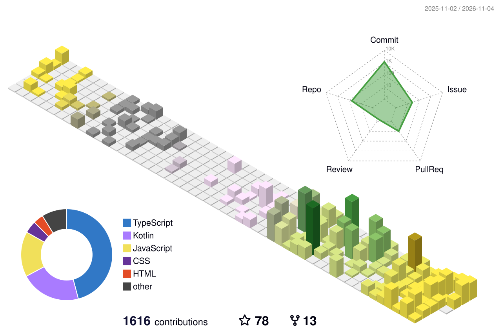

  

  
  
  

---

## About

Software engineer focused on offline-first architectures, mobile security engineering, and distributed web applications. Published author of two open-source Android applications on F-Droid: **VaultX** and **WebStack**.

- **Mobile Security & Android**: Author and maintainer of [VaultX](https://github.com/Chiranth-Janardhan-moger/vaultx-offline-password-manager) (100% offline password vault with hardware KeyStore encryption) and [WebStack](https://github.com/Chiranth-Janardhan-moger/webstack) (visual bookmark and link stack manager for Android), both published on [F-Droid](https://f-droid.org).
- **Application & Network Security**: Author of [FortifyJS](https://github.com/Chiranth-Janardhan-moger/fortifyjs) (zero-dependency in-process WAF and GenAI prompt-injection defense), [SQLGuardJS](https://github.com/Chiranth-Janardhan-moger/sqlguardjs) (AST-heuristic SQLi/XSS/NoSQL verification middleware), and [hybrid-ids](https://github.com/Chiranth-Janardhan-moger/hybrid-ids) (Suricata + Balanced Random Forest ML network IPS).
- **Enterprise Web & Agentic AI**: Architecting production RAG platforms ([MCPPRO](https://github.com/Chiranth-Janardhan-moger/MCPPRO)), enterprise procurement engines ([ProcureFlow](https://github.com/Chiranth-Janardhan-moger/procureflow)), and real-time transit telemetry systems ([ConnectMe](https://github.com/Chiranth-Janardhan-moger/Connect_Me)).

---

## Technical Stack

### Languages & Frameworks

  

### Storage & Tooling

  

---

## Featured Projects

### Mobile Security & Systems (F-Droid Published)
- **[WebStack](https://github.com/Chiranth-Janardhan-moger/webstack)** - Visual bookmark stack and website manager for Android published on [F-Droid](https://f-droid.org/packages/com.chiranth7.webstack/). Built with Jetpack Compose, Material 3 design tokens, and an offline Room DB architecture with full SQLite schema migrations.
- **[VaultX](https://github.com/Chiranth-Janardhan-moger/vaultx-offline-password-manager)** - Open-source offline credential vault published on [F-Droid](https://f-droid.org/packages/com.chiranth7.vaultx/). Features zero network permissions, hardware Android KeyStore biometric authentication, PBKDF2 key derivation (100,000 iterations), and AES-256-CBC with HMAC-SHA256 authenticated encryption.

### Application & Network Security
- **[FortifyJS](https://github.com/Chiranth-Janardhan-moger/fortifyjs)** - High-performance, zero-dependency in-process Web Application Firewall (WAF) and GenAI security suite for Node.js. Sub-millisecond defense across 15 OWASP web vectors alongside real-time LLM prompt injection and jailbreak protection.
- **[SQLGuardJS](https://github.com/Chiranth-Janardhan-moger/sqlguardjs)** - Zero-dependency request verification middleware for Express protecting against SQL Injection, reflected XSS, and NoSQL injection using AST token heuristics and structured security audit logging.
- **[Hybrid IDS / IPS](https://github.com/Chiranth-Janardhan-moger/hybrid-ids)** - Network intrusion detection and prevention system combining deterministic Suricata signature rules with a Balanced Random Forest flow anomaly classifier, automated Linux iptables mitigation, and a 4-tier visual analytics dashboard.

### Enterprise Platforms & Agentic AI
- **[ProcureFlow](https://github.com/Chiranth-Janardhan-moger/procureflow)** - Enterprise procurement and vendor lifecycle management platform built with React 18, Vite, Node.js, Express, and Neon PostgreSQL. Verified with 83 automated CI/CD tests and empirically stress-tested to 1,500 concurrent connections.
- **[MCPPRO](https://github.com/Chiranth-Janardhan-moger/MCPPRO)** - Production RAG and AI Agent orchestration platform built with FastAPI, Next.js, and vector databases, implementing the Model Context Protocol (MCP) for autonomous multi-turn tool calling.
- **[ConnectMe](https://github.com/Chiranth-Janardhan-moger/Connect_Me)** - Real-time transit telemetry and fleet management platform built with React Native, Node.js, and Socket.io with live GPS WebSocket streaming, predictive ETA algorithms, and geofence push alerts.

### Cloud FinOps & Deep Learning
- **[CloudPulse](https://github.com/Chiranth-Janardhan-moger/CloudPulse)** - Cloud infrastructure monitoring and cost optimization platform integrating the AWS CloudWatch SDK to detect idle EC2 instances, calculate projected monthly cloud waste, and automate remediation.
- **[The Silent Cry Decoder](https://github.com/Chiranth-Janardhan-moger/The-Silent-Cry-Decoder)** - Deep learning acoustic classification system combining CNN log-mel spectrogram extraction, BiLSTM temporal sequence modeling, and Whisper audio representations to classify infant cry signatures.

---

## GitHub Analytics

  
  

  

---

## Contribution Activity

  

  
<strong>View 3D Contribution Profile</strong>

   
  

    
  

---

## Connect

  
  
  

<!-- Telemetry -->

